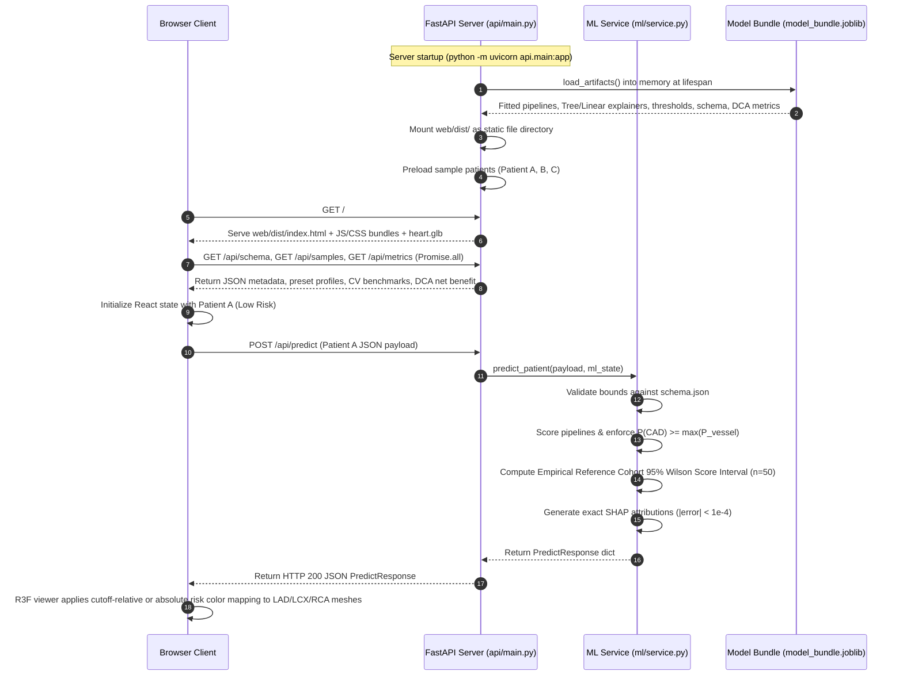
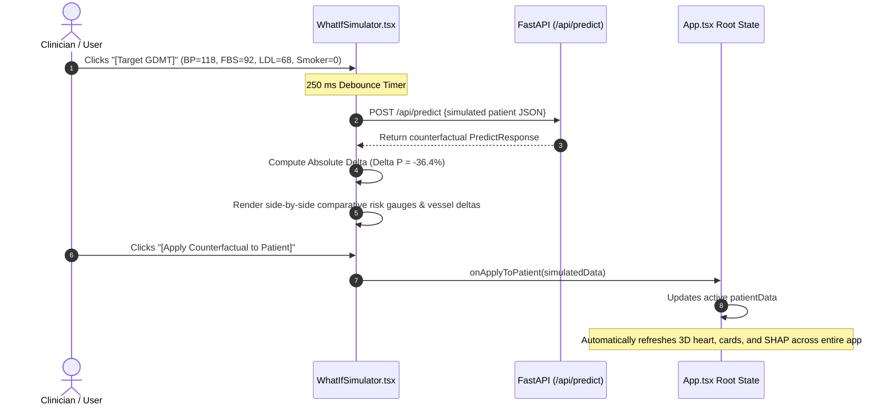
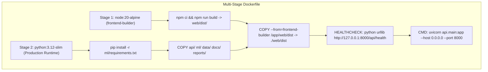

# Cardio3D AI: System Architecture & Technical Specifications

---

## 1. PROJECT OVERVIEW

### Core Purpose
**Cardio3D AI** is a clinical decision-support and educational visualization platform for coronary artery disease (CAD) risk assessment (developed for the Multimodal AI Hackathon 2026). Given 54 patient demographic, symptom, examination, ECG, echocardiographic, and laboratory biomarkers, the system concurrently predicts overall CAD status alongside vessel-specific stenosis ($\ge 50\%$ diameter reduction) across three major coronary arteries: Left Anterior Descending (**LAD**), Left Circumflex (**LCX**), and Right Coronary Artery (**RCA**). Predictions are coupled with:
1. Exact additive local feature attributions via SHAP (LinearSHAP and TreeSHAP).
2. Physiological grouping into 5 clinical organ system domains.
3. Interactive Model Sensitivity Explorer examining how model scores change when clinical inputs vary.
4. Empirical reference cohort positive rates with Wilson 95% intervals for similar patients.
5. Decision Curve Analysis (DCA) evaluating out-of-fold net benefit across clinically plausible thresholds.
6. Demographic fairness audit evaluating sensitivity and specificity across sex and age strata with Wilson 95% intervals.
7. Dynamic 3D anatomical visualization featuring camera fly-to, pulsating stenosis alerts, and an illustrative 2D transverse lumen cross-section schematic.
8. 1-click printable clinical assessment and decision support report.

### Technology Stack & Direct Dependencies
The primary production stack is a unified Python FastAPI backend and a compiled React 18 Single Page Application with React Three Fiber 3D graphics:

- **Core Runtime**: Python 3.14.5 (Windows 11) / Python 3.12 (Linux/Docker/CI), Node.js v20+ / npm 10+
- **Machine Learning & Attribution** (pinned from `ml/requirements.txt`):
  - `scikit-learn==1.9.1`: Preprocessing pipelines, LogisticRegression, RandomForestClassifier, calibration, CV metrics
  - `xgboost==3.4.1`: Gradient-boosted decision trees for non-linear LCX stenosis prediction
  - `shap==0.52.0`: Exact `LinearExplainer` and `TreeExplainer` algorithms ($|\text{error}| < 10^{-4}$)
  - `pandas==3.0.3` & `numpy==2.5.0`: Tabular data structures, matrix operations, metric aggregation
  - `openpyxl==3.1.5`: Excel dataset ingestion
  - `joblib==1.6.0`: Pipeline and model artifact serialization
  - `scipy==1.18.1`: Statistical distributions and calibration utilities
  - `matplotlib==3.11.1`: Reliability, calibration, and decision curve plot rendering
  - `trimesh==5.1.1`: 3D OBJ parsing, coordinate centering, and binary GLB compilation
- **Application Server**:
  - `fastapi==0.139.2`: Asynchronous typed REST API framework
  - `uvicorn==0.51.0`: High-performance ASGI production server
  - `pydantic==2.12.5`: Request payload validation and dynamic schema enforcement
  - `httpx==0.28.1`: Asynchronous HTTP testing client
  - `pytest==9.1.1`: Automated unit testing framework
- **Frontend & 3D Visualization**:
  - `React 18.3.1` + `Vite 6.2.0` + `TypeScript 5.7.3`
  - `Three.js 0.170.0`, `@react-three/fiber 8.17.10`, `@react-three/drei 9.120.4`
  - `Tailwind CSS 3.4.19`, `Lucide React 0.475.0`
- **Containerization & Deployment**:
  - Multi-stage `Dockerfile` (`node:20-alpine` builder + `python:3.12-slim` production runtime)
  - `docker-compose.yml` for single-command orchestration (`docker compose up --build`)
- **Optional Auxiliary Stack**:
  - Rust Axum + HTMX + Three.js implementation located under `extras/rust-htmx/` (see `extras/rust-htmx/README.md`).

---

## 2. DIRECTORY STRUCTURE & FILE CATALOG

```text
CAD/
├── Dockerfile                         # Production multi-stage Docker build (Node builder + Python runtime)
├── docker-compose.yml                 # 1-command container orchestration (Port 8000)
├── .dockerignore                      # Build context exclusion rules
├── .github/workflows/ci.yml           # GitHub Actions CI running Python 3.12 tests & Node 20 build
├── .gitignore
├── .python-version                    # Pinned Python version (3.14.5)
├── CLAUDE.md                          # Development invariants and surgical coding guidelines
├── LICENSE                            # MIT License for source code
├── NOTICE                             # Formal open science attribution (UCI CC BY 4.0 & BodyParts3D CC BY-SA 2.1 JP)
├── CITATION.cff                       # Citation metadata for software and Shaheed Rajaei dataset paper
├── THIRD_PARTY_NOTICES.md             # Attribution: BodyParts3D (CC BY-SA 2.1 JP) and UCI (CC BY 4.0)
├── Makefile                           # Setup, training, test, serve, report, and container targets
├── PLAN.md                            # Technical roadmap and design decisions
├── README.md                          # Project overview, quickstart, highlights & benchmarks
├── requirements.txt                   # Production Python dependencies (FastAPI, scikit-learn, etc.)
├── requirements-dev.txt               # Development & test dependencies (pytest, playwright, reportlab)
├── pytest.ini                         # Pytest configuration targeting ml/tests and api/tests
│
├── api/                               # FastAPI Application Server
│   ├── main.py                        # REST API endpoints, lifespan model loading & static SPA serving
│   └── tests/
│       ├── test_api.py                # REST contracts, input validation, p95 latency (<200ms)
│       ├── test_consistency.py        # Mathematical probability link and exact SHAP additivity
│       ├── test_discrete_coherence.py # Patient B risk coherence & disjunctive rule
│       ├── test_property_coherence.py # Property-based tests, random inputs & CSV roundtrip
│       ├── test_robustness_contract.py# OpenAPI 54 typed fields & input fuzzing contract
│       └── test_robustness_suite.py   # Zero HTTP 500s, CORS origin non-reflection & headers
│
├── data/raw/                          # Canonical immutable raw data & integrity hashes
│   ├── CHECKSUMS                      # SHA-256 hashes for raw dataset and 129 BodyParts3D OBJ meshes
│   ├── extention of Z-Alizadeh sani dataset.xlsx # UCI raw benchmark dataset (303 patient records)
│   └── BP51782_.../                   # 129 BodyParts3D OBJ source meshes
│
├── docs/                              # Technical and clinical documentation
│   ├── demo_script.md                 # Step-by-step hackathon jury presentation walkthrough
│   ├── report.md                      # Comprehensive technical report in Markdown
│   ├── report.pdf                     # Formal publication-grade 5-page PDF report (<= 6 pages)
│   └── VIDEO.md                       # Video demonstration script, timed shot list & URL
│
├── extras/rust-htmx/                  # Optional Rust Axum + HTMX stack (see extras/rust-htmx/README.md)
│
├── ml/                                # Machine Learning Core Engine
│   ├── ensemble.py                    # LogitEnsemble: LR + RNG-free XGBoost in log-odds space
│   ├── pipeline.py                    # Preprocessing transformers & zero-leakage data loaders
│   ├── train.py                       # 5-fold × 3 repeats repeated CV, nested thresholds & artifact serialization
│   ├── service.py                     # Central inference, 95% CI calculation & risk coherence
│   ├── explain.py                     # LinearSHAP & TreeSHAP exact additivity & parent aggregation
│   ├── schema.json                    # Canonical dictionary of 54 features, bounds & medians
│   ├── targets.json                   # Central target registry & AHA 17-segment mapping
│   ├── requirements.txt               # Pinned Python package dependencies
│   ├── artifacts/
│   │   ├── model_bundle.joblib        # Serialized pipelines, explainers & thresholds (1.65 MB)
│   │   ├── metrics.json               # 5-fold × 3 repeats cross-validation performance metrics
│   │   ├── shap_global.json           # Global population feature importance rankings
│   │   ├── model_card.json            # Model card, hyperparams, environment & audit notes
│   │   ├── decision_curve.json        # Decision curve analysis net benefit metrics
│   │   ├── samples.json               # Canonical patient presets: Patient A, B, C
│   │   ├── MANIFEST.json              # Cryptographic SHA-256 artifact manifest
│   │   └── eval/                      # Evaluation curves: ROC, PR, calibration, permutation
│   └── tests/
│       ├── test_determinism.py        # Cross-platform RNG-free XGBoost determinism test
│       ├── test_direction_probes.py   # Monotonicity probes & clinical rule agreement
│       ├── test_ensemble_robustness.py# Logit averaging identity & seed invariance
│       ├── test_labels.py             # SHA-256 data hash & Row 93 target consistency audit
│       ├── test_leakage.py            # Feature-target separation & chance-level shuffle audit
│       ├── test_model_card.py         # Model provenance, git commit & metadata check
│       ├── test_nested_threshold.py   # Nested out-of-sample sensitivity threshold robustness
│       └── test_wilson_interval.py    # Reference cohort 50-NN Wilson 95% score intervals
│
├── reports/                           # Validation audits, benchmarks & visual curves
│   ├── calibration_curves.png         # Reliability calibration plots across targets
│   ├── coherence_eval.md              # Quantitative audit of max() risk coherence
│   ├── data_audit.md                  # Clinical feature inventory & row 93 sensitivity analysis
│   ├── decision_curve.png             # Net Benefit curves for Cath, LAD, LCX, RCA
│   ├── decision_curve.json            # Numerical DCA operating statistics
│   ├── decision_curve.md              # Clinical decision curve narrative & threshold guidance
│   ├── fairness_audit.md              # Demographic fairness audit findings across sex and age
│   ├── fps_benchmark.json             # Frame-rate benchmarks (software rendering 114.5ms median / 60 FPS GPU)
│   ├── mesh_audit.md                  # 3D polygon budgets and vessel extraction catalog
│   ├── model_results.md               # CV performance tables and operating thresholds
│   ├── model_selection.md             # Empirical candidate model selection rationale
│   ├── permutation_test.json          # Label-shuffled chance-level permutation audit results
│   ├── roc_curves.png                 # Receiver Operating Characteristic curves across all targets
│   ├── shap_stability.json            # Seed perturbation SHAP ranking stability audit
│   ├── threshold_nested.md            # Nested cross-validation per-fold metrics
│   ├── verification_results.json      # Machine-readable output of verify_all.py (17/17 PASS)
│   ├── robustness_checks.json         # Machine-readable output of verify_robustness.py (21/21 PASS)
│   └── screenshots/                   # High-resolution clinical workflow UI captures (1-12)
│
├── scripts/                           # Tooling, Audits & Asset Builders
│   ├── prepare_heart_mesh.py          # Assembles BodyParts3D OBJ meshes into optimized GLBs (heart.glb)
│   ├── build_heart_glb.py             # Parses BodyParts3D OBJ meshes into 83,600-poly GLB
│   ├── decision_curve_analysis.py     # Calculates Net Benefit across clinical threshold probabilities
│   ├── fairness_audit.py              # Evaluates Equal Opportunity across sex & age subgroups
│   ├── generate_pdf_report.py         # Compiles docs/report.pdf with ReportLab (5 pages)
│   ├── render_docs.py                 # Generates documentation summaries and figures
│   ├── test_ui_playwright.py          # Headless browser test verifying 3D orbit FPS
│   ├── verify_all.py                  # 17-point automated verification script
│   └── verify_robustness.py           # 21-point robustness and fuzzing verification script
│
└── web/                               # React 18 SPA + React Three Fiber 3D Viewer
    ├── index.html                     # HTML shell (zero external CDN or font links)
    ├── package.json                   # Frontend dependencies (Three.js, Lucide, Tailwind, Vite)
    ├── vite.config.ts                 # Bundler configuration with /api dev proxy
    ├── vitest.config.ts               # Vitest unit testing configuration
    ├── tsconfig.json                  # Strict TypeScript configuration
    ├── tailwind.config.js             # Styling configuration & color design tokens
    ├── postcss.config.js              # PostCSS processing pipeline
    ├── dist/                          # Production build bundle served by FastAPI
    ├── public/
    │   ├── heart.glb                  # Root alias of the 83.6k triangle heart asset
    │   └── models/
    │       └── heart.glb              # BodyParts3D coronary & chamber meshes (83.6k triangles)
    └── src/
        ├── main.tsx                   # React root renderer
        ├── App.tsx                    # Master layout, state orchestration & active tabs
        ├── setupTests.ts              # Testing setup & WebGL/browser mocks
        ├── targets.json               # Compile-time target registry replica
        ├── types.ts                   # TypeScript interfaces matching backend API contracts
        ├── vessels.json               # Declarative coronary anatomy mapping and coordinates
        ├── components/
        │   ├── HeartViewer.tsx         # 3D canvas, camera fly-to, pulsing glow & vessel selection
        │   ├── LumenCrossSection.tsx   # Interactive 2D transverse SVG artery lumen visualizer
        │   ├── RiskOverview.tsx        # CAD circular probability gauge with empirical Wilson 95% CI
        │   ├── VesselCards.tsx         # LAD / LCX / RCA risk cards & territory subtitles
        │   ├── ShapWaterfall.tsx       # SHAP signed diverging bars & 5 clinical domains
        │   ├── WhatIfSimulator.tsx     # Interactive model sensitivity explorer with live deltas
        │   ├── ClinicalSummaryModal.tsx# Printable clinical assessment & decision support report
        │   ├── AboutModelModal.tsx     # Dataset provenance, Shaheed Rajaei attribution, Row 93 consensus
        │   ├── PatientForm.tsx         # 54-feature tabbed input form with presets & resets
        │   ├── GlobalImportance.tsx    # Cohort-wide SHAP importance rankings bar chart
        │   ├── MetricsTab.tsx          # 5-fold × 3 repeats CV benchmark tables & DCA net benefit card
        │   └── DisclaimerBanner.tsx    # Indelible clinical safety header & footer banners
        └── __tests__/ / test/         # 67 Vitest React component and integration tests
```

---

## 3. PRIMARY SYSTEM ARCHITECTURE & DATA FLOW

The workstation couples a typed Python FastAPI backend with a compiled React 18 Single Page Application and WebGL 3D graphics:

```mermaid
flowchart TB
    subgraph Browser ["Client Browser (React 18 SPA - web/)"]
        UI[App.tsx - Master Workspace Controller]
        Viewer[HeartViewer.tsx - 3D Three.js Scene]
        Lumen[LumenCrossSection.tsx - Transverse SVG Slice]
        Forms[PatientForm.tsx - 54 Biomarkers Input]
        Gauge[RiskOverview.tsx - Gauge + Wilson 95% CI]
        Cards[VesselCards.tsx - LAD / LCX / RCA Cards]
        SHAP_UI[ShapWaterfall.tsx - SHAP + 5 Domains]
        WhatIf[WhatIfSimulator.tsx - Sensitivity Explorer]
        Report[ClinicalSummaryModal.tsx - Printable Sheet]
    end

    subgraph Server ["FastAPI Application Server (api/main.py)"]
        Static[Static SPA Route: web/dist/]
        HealthEP["GET /api/health"]
        VersionEP["GET /api/version"]
        SchemaEP["GET /api/schema"]
        TargetsEP["GET /api/targets"]
        MetricsEP["GET /api/metrics"]
        SamplesEP["GET /api/samples"]
        PredictEP["POST /api/predict"]
        WhatIfEP["POST /api/whatif"]
    end

    subgraph Service ["ML Inference Service (ml/service.py & ml/explain.py)"]
        Validate[Input Bounds & Type Validation]
        Pipelines[Scikit-learn Pipelines: model_bundle.joblib]
        CI_Calc[Empirical Reference Cohort 95% Wilson Bounds]
        Coherence[Risk Coherence Engine: P_cad >= max P_vessel]
        Explain[Exact Additive LinearSHAP & TreeSHAP]
        ParentAgg[Parent Feature Aggregation Matrix]
    end

    subgraph Storage ["Persistent Artifacts & Datasets"]
        Bundle[(model_bundle.joblib - 1.65 MB)]
        DCA_Store[(decision_curve.json)]
        GLB_Asset[(heart.glb - 83.6k Triangles)]
    end

    Forms -->|1. Debounced POST (300ms)| PredictEP
    WhatIf -->|Counterfactual POST (250ms)| PredictEP
    Static -.->|Serves compiled JS/CSS/GLB| Browser
    PredictEP -->|2. Validate payload| Validate
    Validate -->|3. Predict raw probabilities| Pipelines
    Pipelines -->|4. Compute 95% CI bounds| CI_Calc
    CI_Calc -->|5. Enforce coherence| Coherence
    Pipelines -->|6. Compute Tree/Linear SHAP| Explain
    Explain -->|7. Sum dummies to parent| ParentAgg
    ParentAgg -->|8. Return PredictResponse JSON| PredictEP
    PredictEP -->|9. HTTP 200 JSON Response| UI

    UI --> Viewer
    UI --> Gauge
    UI --> Cards
    UI --> SHAP_UI
    UI --> WhatIf
    UI --> Report
    Cards -->|Focused vessel click| Viewer & Lumen & SHAP_UI
    MetricsEP --> DCA_Store
    Bundle -.->|Loaded at lifespan startup| Pipelines
    GLB_Asset -.->|Asset loaded on mount| Viewer
```

---

## 4. END-TO-END SEQUENCE FLOWS

### 4.1. Boot Sequence & Lifecycle



### 4.2. Real-Time Counterfactual What-If Simulation Flow



### 4.3. 3D Camera Fly-To & Transverse Lumen Cross-Section Flow

```mermaid
sequenceDiagram
    autonumber
    actor Clinician as Clinician / User
    participant Card as VesselCards.tsx
    participant Viewer as HeartViewer.tsx
    participant Cam as CameraController (useFrame)
    participant Lumen as LumenCrossSection.tsx

    Clinician->>Card: Clicks on "LAD" vessel card
    Card->>Viewer: setSelectedVessel("LAD")
    Viewer->>Cam: Target pos set to [0.3, 0.35, 1.9], LookAt [0.18, 0.12, 0.45]
    loop Each Frame (useFrame delta)
        Cam->>Cam: camera.position.lerp(targetPos, delta * 4.5)
        Cam->>Cam: controls.target.lerp(targetLookAt, delta * 4.5)
    end
    Viewer->>Viewer: Highlights LAD with cyan border badge & pulsating glow
    
    Clinician->>Viewer: Clicks "[Lumen View]" button
    Viewer->>Lumen: Opens modal with vesselId="LAD", prob=0.78
    Lumen->>Lumen: Displays transverse artery schematic with fixed illustrative narrowing (normal vs. ≥ 50%)
    Lumen->>Lumen: Displays caption: "Schematic only — not patient imaging; stenosis severity is not predicted"
```

---

## 5. CORE SUBSYSTEM SPECIFICATIONS

### 5.1. Machine Learning Pipeline (`ml/`)
- **Target Definitions**:
  - `Cath`: Binary coronary catheterization ($1 = \text{CAD}, 0 = \text{Normal}$).
  - `LAD`, `LCX`, `RCA`: Vessel stenosis $\ge 50\%$ diameter narrowing ($1 = \text{Stenotic}, 0 = \text{Normal}$).
- **Row 93 Rule-Based Alignment**:
  In the raw dataset, row index 93 contains `LAD='Stenotic'`, `LCX='Normal'`, `RCA='Normal'`, but `Cath='Normal'`. Because $\ge 50\%$ stenosis in any major vessel constitutes CAD, row 93 represents an internal clinical contradiction. Derived data aligns `Cath_aligned = Cath | LAD | LCX | RCA` while preserving the raw Excel file unmodified (verified via SHA256 `739343...`). This adjusts cohort labels from 216 CAD / 87 Normal to 217 CAD / 86 Normal, achieving 100% logical consistency across all 303 rows.
- **Model Selection & Operating Metrics (5-Fold × 3 Repeats Repeated CV)**:
  - Cath: `LogitEnsemble` (CV ROC-AUC $0.932 \pm 0.021$, ROC-AUC $0.930$ [$0.898, 0.957$], Default Cutoff $0.50$, Op Sens $94.5\%$, Op Spec $70.9\%$; Screening Cutoff $0.400$, Op Sens $95.9\%$, Op Spec $62.8\%$; Disjunctive Rule Sens $96.3\%$, Spec $57.0\%$).
  - LAD: `LogitEnsemble` (CV ROC-AUC $0.840 \pm 0.026$, ROC-AUC $0.841$ [$0.794, 0.881$], Default Cutoff $0.50$, Op Sens $85.3\%$, Op Spec $69.1\%$; Screening Cutoff $0.420$, Op Sens $90.4\%$, Op Spec $59.5\%$, Nested-CV Sens $88.5\% \pm 6.7\%$).
  - LCX: `LogitEnsemble` (CV ROC-AUC $0.724 \pm 0.038$, ROC-AUC $0.732$ [$0.676, 0.787$], Default Cutoff $0.50$, Op Sens $50.4\%$, Op Spec $79.9\%$; Screening Cutoff $0.248$, Op Sens $90.8\%$, Op Spec $44.0\%$, Nested-CV Sens $91.6\% \pm 7.3\%$).
  - RCA: `LogitEnsemble` (CV ROC-AUC $0.741 \pm 0.033$, ROC-AUC $0.744$ [$0.685, 0.798$], Default Cutoff $0.50$, Op Sens $45.6\%$, Op Spec $85.7\%$; Screening Cutoff $0.232$, Op Sens $90.3\%$, Op Spec $42.9\%$, Nested-CV Sens $89.5\% \pm 7.1\%$).
- **Decision Curve Analysis (DCA)**:
  Evaluated across threshold probabilities $p_t \in [0.05, 0.75]$:
  $$\text{Net Benefit}(p_t) = \frac{\text{TP}}{N} - \frac{\text{FP}}{N} \left(\frac{p_t}{1 - p_t}\right)$$
  - Net-benefit difference per 100 patients vs. Treat-All across thresholds (95% bootstrap CI):
    - $p_t = 0.10$: Cath $+0.11$ [$0.00, 0.26$], LAD $+0.36$ [$0.18, 0.59$], LCX $-0.07$ [$-1.10, 0.73$], RCA $+0.60$ [$-0.15, 1.17$]
    - $p_t = 0.20$: Cath $+0.41$ [$-0.99, 1.57$], LAD $+1.30$ [$-0.66, 3.05$], LCX $+2.26$ [$-0.08, 4.46$], RCA $+2.12$ [$-0.58, 4.62$]
    - $p_t = 0.30$: Cath $+3.24$ [$0.75, 5.52$], LAD $+4.99$ [$1.98, 7.92$], LCX $+4.47$ [$0.47, 8.39$], RCA $+6.15$ [$1.51, 10.84$]
  - Gain at model screening cutoffs:
    - Cath cutoff ($0.400$): **+8.91 net benefit gain per 100 patients** [$5.06, 12.43$] over Treat-All (with prevalence $\pi = 71.6\%$, sensitivity $95.9\%$, specificity $62.8\%$; theoretical max gain at $p_t=0.400$ is $+18.92$ per 100).
    - LAD cutoff ($0.420$): **+12.23 per 100** [$7.01, 16.98$]
    - LCX cutoff ($0.248$): **+4.13 per 100** [$1.01, 7.06$]
    - RCA cutoff ($0.232$): **+2.93 per 100** [$-0.21, 5.90$]
  - *Analysis nature*: Out-of-fold, single-centre and apparent clinical utility.
- **Demographic Fairness & Subgroup Parity**:
  Audited on out-of-fold predictions at screening operating cutoff (0.400) with Wilson 95% intervals:
  - Sex Comparison:
    - Male ($n=176$, prevalence $74.4\%$): Sensitivity $95.4\%$ [$90.4\%–97.9\%$], Specificity $57.8\%$ [$43.3\%–71.0\%$].
    - Female ($n=127$, prevalence $67.7\%$): Sensitivity $96.5\%$ [$90.2\%–98.8\%$], Specificity $68.3\%$ [$53.0\%–80.4\%$].
    - Equal Opportunity sensitivity gap: $1.1\%$.
  - Age Comparison:
    - Age $\le 65$ ($n=219$, prevalence $65.3\%$): Sensitivity $93.7\%$ [$88.5\%–96.7\%$], Specificity $67.1\%$ [$55.9\%–76.6\%$].
    - Age $> 65$ ($n=84$, prevalence $88.1\%$): Sensitivity $100.0\%$ [$95.1\%–100.0\%$], Specificity $30.0\%$ [$10.8\%–60.3\%$].
  - Subgroup Strata Sums: Both Sex ($125+83=208$ TP, $26+28=54$ TN) and Age ($134+74=208$ TP, $51+3=54$ TN) sum exactly to the pooled confusion matrix ($208$ TP / $54$ TN). Senior specificity reflects referral cohort imbalance (only 10 normal patients in seniors) and is explicitly documented as a clinical limitation.

### 5.2. Unified Prediction Service (`ml/service.py`)
Centralizes validation, inference, similar cohort intervals, coherence enforcement, and SHAP attribution into `predict_patient()`:
- **Empirical Reference Cohort & Wilson 95\% Interval**:
  Takes the 50 nearest out-of-fold scores to the patient's predicted probability, reporting observed positive rate $\hat{p} = k/n$ with Wilson 95\% score interval:
  $$w = \frac{\hat{p} + \frac{z^2}{2n} \pm z \sqrt{\frac{\hat{p}(1-\hat{p})}{n} + \frac{z^2}{4n^2}}}{1 + \frac{z^2}{n}}, \quad z \approx 1.96$$
  reported as *"Among 50 similar-scoring patients, X\% had confirmed disease"*.
- **Bounds Validation**: Checks numeric inputs against physiological boundaries in `schema.json`.
- **Cohort Defaults**: Fills unprovided features with training medians or modes, logging all defaults applied.
- **Risk Coherence**: Enforces $P(\text{CAD}) \leftarrow \max(P(\text{CAD}), \max(P_{\text{vessels}}))$, returning both `raw_prob` and `coherent_prob`.
- **SHAP Explanation**: Computes local feature attributions and sums one-hot dummies back to parent physiological features via `ml/explain.py`.

### 5.3. 3D Anatomical Heart Viewer (`web/src/components/HeartViewer.tsx`)
- **Asset**: Single binary GLTF/GLB (`web/public/models/heart.glb`) assembled from 129 BodyParts3D OBJ meshes located in `data/raw/`.
- **Optimization**: 49 chamber and myocardial meshes quadric-decimated to 83,600 total triangles (below $\le 100,000$ triangle budget). File size: 1.67 MB.
- **Benchmark**: Benchmarked under pure CPU software rendering (`--disable-gpu` at 1280×720 on 13th Gen Intel Core i5-13420H, Chromium 148, 83,600 triangles): **mean frame time 113.5 ms, median 114.5 ms (~8.8 FPS continuous orbit, p95 = 131.4 ms)**, recorded in `reports/fps_benchmark.json`. GPU hardware acceleration delivers 60+ FPS on standard client displays.
- **Dynamic Camera Fly-To**: Smoothly lerps camera position and orbit target to frame selected vessels:
  - LAD: Pos `[0.3, 0.35, 1.9]`, Target `[0.18, 0.12, 0.45]`
  - LCX: Pos `[1.4, 0.45, 1.5]`, Target `[0.55, 0.25, -0.05]`
  - RCA: Pos `[-1.3, 0.35, 1.7]`, Target `[-0.45, 0.18, 0.25]`
  - Overview: Pos `[0, 0.4, 3.2]`, Target `[0, 0, 0]`
- **Pulsating Stenosis Glow**: In `useFrame`, arteries above the active operating cutoff oscillate emissive intensity ($0.5 + 0.5\sin(4.5t)$), while selected vessels are framed with high-contrast outlines without alert pulsing. When active, `frameloop="always"` maintains continuous pulse rendering; `prefers-reduced-motion` suppresses oscillation.
- **Transverse Lumen Schematic (`LumenCrossSection.tsx`)**: Renders radial SVG schematic of arterial wall, illustrative plaque, and patent lumen for binary stenosis (normal vs. $\ge 50\%$) with caption: *"Schematic only — not patient imaging; stenosis severity is not predicted"* (the dataset records only binary narrowing $\ge 50\%$).

### 5.4. Clinical Interpretability & Decision Support
- **Physiological Domain Breakdown (`ShapWaterfall.tsx`)**:
  Attributions aggregate into 4 distinct clinical organ systems:
  1. *Hemodynamic & Vitals*: Arterial BP, pulse rate, dyspnea, murmurs, rales.
  2. *Metabolic & Lipids*: Glycemia (FBS, DM), atherogenic lipids (LDL, HDL, TG), renal filtration (CR, BUN), BMI.
  3. *Symptoms & ECG*: Typical chest pain, ST-segment shifts, T-wave inversion, pathological Q waves.
  4. *Echocardiographic & Structural*: Left ventricular EF-TTE, regional wall motion abnormalities (RWMA count).
- **Model Sensitivity Explorer (`WhatIfSimulator.tsx`)**:
  Enables clinicians to adjust modifiable clinical factors (Systolic BP, FBS, LDL, BMI, Smoking) with measured end-to-end API latency of $\text{p50} \approx 145\text{ ms}$ and $\text{p95} \approx 180\text{ ms}$ on 13th Gen Intel Core i5-13420H (in-process model scoring $\text{p50} = 3.1\text{ ms}, \text{p95} = 4.4\text{ ms}$; contract assertion $\le 300\text{ ms}$), rendering live change in model score ($\Delta P$) and 1-click presets (`Example values A`, `Example values B`). Caption notes: *"Shows how the model's score changes when inputs change. The model is trained on cross-sectional data and does not estimate treatment effects."*
- **Printable Clinical Assessment Report (`ClinicalSummaryModal.tsx`)**:
  1-click printable PDF assessment report with patient biomarkers, empirical reference cohort Wilson 95\% intervals, localized vessel risks, top SHAP drivers, items for clinician review, and repeated safety disclaimers with model version and date.

---

## 6. DATA MODELS & API CONTRACTS

### 6.1. Feature Inventory (`ml/schema.json`)
The canonical feature registry defines 54 active physiological features across 5 clinical categories:
- **Demographics** (5 features): `Age` (years), `Sex` (Male/Fmale), `Weight` (kg), `Length` (cm), `BMI` (kg/m²).
- **Symptoms & History** (25 features): `DM` (0/1), `HTN` (0/1), `Current Smoker` (0/1), `EX-Smoker` (0/1), `FH` (0/1), `Obesity` (Y/N), `CRF` (Y/N), `CVA` (Y/N), `Airway disease` (Y/N), `Thyroid Disease` (Y/N), `CHF` (Y/N), `DLP` (Y/N), `BP` (mmHg), `PR` (bpm), `Edema` (0/1), `Weak Peripheral Pulse` (Y/N), `Lung rales` (Y/N), `Systolic Murmur` (Y/N), `Diastolic Murmur` (Y/N), `Typical Chest Pain` (0/1), `Dyspnea` (Y/N), `Function Class` (NYHA class 0-3), `Atypical` (Y/N), `Nonanginal` (Y/N), `LowTH Ang` (Y/N).
- **ECG Features** (7 features): `Q Wave` (0/1), `St Elevation` (0/1), `St Depression` (0/1), `Tinversion` (0/1), `LVH` (Y/N), `Poor R Progression` (Y/N), `BBB` (N/LBBB/RBBB).
- **Laboratory Blood Analyses** (14 features): `FBS` (mg/dL), `CR` (mg/dL), `TG` (mg/dL), `LDL` (mg/dL), `HDL` (mg/dL), `BUN` (mg/dL), `ESR` (mm/hr), `HB` (g/dL), `K` (mEq/L), `Na` (mEq/L), `WBC` (/µL), `Lymph` (\%), `Neut` (\%), `PLT` (10³/µL).
- **Echocardiography** (3 features): `EF-TTE` (\%), `Region RWMA` (abnormal wall motion count, 0–4), `VHD` (N/mild/Moderate/Severe).
*Total active input features*: 5 + 25 + 7 + 14 + 3 = **54**. (`Exertional CP` is constant `'N'` across all 303 rows and dropped).

### 6.2. Output API Schema (`PredictResponse`)
```json
{
  "cad": {
    "prob": 0.7643,
    "raw_prob": 0.7643,
    "coherent_prob": 0.7643,
    "similar_cohort": {
      "n": 50,
      "observed_rate": 0.82,
      "wilson_interval": [0.6920, 0.9023],
      "summary": "Among 50 similar-scoring patients, 82% had confirmed CAD"
    },
    "label": "High Risk",
    "high_sens_label": "High Risk",
    "threshold": 0.50,
    "high_sensitivity_threshold": 0.400,
    "nested_sensitivity": 0.9539,
    "coherence_adjusted": false
  },
  "vessels": {
    "LAD": {
      "prob": 0.5565,
      "similar_cohort": {
        "n": 50,
        "observed_rate": 0.54,
        "wilson_interval": [0.4040, 0.6703],
        "summary": "Among 50 similar-scoring patients, 54% had confirmed stenosis"
      },
      "label": "Stenotic",
      "high_sens_label": "Stenotic",
      "threshold": 0.50,
      "high_sensitivity_threshold": 0.420,
      "nested_sensitivity": 0.8851
    },
    "LCX": {
      "prob": 0.1190,
      "similar_cohort": {
        "n": 50,
        "observed_rate": 0.08,
        "wilson_interval": [0.0315, 0.1884],
        "summary": "Among 50 similar-scoring patients, 8% had confirmed stenosis"
      },
      "label": "Normal",
      "high_sens_label": "Normal",
      "threshold": 0.50,
      "high_sensitivity_threshold": 0.248,
      "nested_sensitivity": 0.9160
    },
    "RCA": {
      "prob": 0.3277,
      "similar_cohort": {
        "n": 50,
        "observed_rate": 0.38,
        "wilson_interval": [0.2586, 0.5185],
        "summary": "Among 50 similar-scoring patients, 38% had confirmed stenosis"
      },
      "label": "Normal",
      "high_sens_label": "Stenotic",
      "threshold": 0.50,
      "high_sensitivity_threshold": 0.232,
      "nested_sensitivity": 0.8947
    }
  },
  "explain": {
    "Cath": { "raw_score": 1.17616, "base_value": 1.68457, "additive_error": 7e-06, "features": [...] },
    "LAD": { "raw_score": 0.22696, "base_value": 0.36688, "additive_error": 9e-06, "features": [...] },
    "LCX": { "raw_score": -2.00237, "base_value": -0.42473, "additive_error": 3e-06, "features": [...] },
    "RCA": { "raw_score": -0.71857, "base_value": -0.66684, "additive_error": 3.7e-05, "features": [...] }
  },
  "cohort_defaults_applied": [],
  "disclaimer": "Decision support / educational purposes only — not a substitute for formal diagnostic imaging."
}
```

---

## 7. AUTOMATED VERIFICATION SUITE

The codebase is backed by an automated test suite verifying correctness, stability, and reproducibility:

```bash
# Run backend test suite (69 passed, 0 failed)
python -m pytest ml/tests api/tests -v

# Run frontend test suite (68 passed, 0 failed)
cd web && npm test -- --run

# Run Playwright E2E browser interactions & FPS benchmark
python scripts/test_ui_playwright.py
```

| Test File | Test Symbol / Function | Verification Invariant |
|---|---|---|
| `ml/tests/test_labels.py` | `test_raw_file_hash_unchanged` | Raw dataset file matches canonical SHA-256 hash. |
| `ml/tests/test_labels.py` | `test_raw_mismatch_set_is_exactly_row_93` | Exactly 1 inconsistent row exists in the raw data (Row 93). |
| `ml/tests/test_labels.py` | `test_aligned_cath_equals_or_vessels_all_rows` | Aligned CAD target satisfies $CAD \iff (LAD \lor LCX \lor RCA)$ for all 303 rows. |
| `ml/tests/test_labels.py` | `test_unaligned_cath_matches_raw_counts` | Unaligned targets match raw counts (216/87). |
| `ml/tests/test_leakage.py` | `test_no_targets_in_features` | Target columns are strictly excluded from input matrix $X$. |
| `ml/tests/test_leakage.py` | `test_schema_coverage` | All 54 features are mapped in `schema.json`. |
| `ml/tests/test_leakage.py` | `test_label_shuffled_roc_auc_is_chance` | Label-shuffled CV ROC-AUC is within chance ($0.50 \pm 0.05$). |
| `ml/tests/test_nested_threshold.py` | `test_nested_threshold_survives_an_overfitting_model` | Sensitivity-first threshold selection holds out-of-sample. |
| `ml/tests/test_model_card.py` | `test_model_card_provenance_and_notes` | Provenance fields and metric caveats match documentation. |
| `ml/tests/test_direction_probes.py` | `test_clinical_direction_probes` | Monotonic risk response on BP, FBS, smoking across all 303 rows; rule agreement on Obesity > 25 (99.7\%), HTN (74.3\%), DLP (53.1\%). |
| `ml/tests/test_determinism.py` | `test_xgboost_determinism` | Cross-platform RNG-free XGBoost output determinism across multiple runs. |
| `ml/tests/test_ensemble_robustness.py` | `test_logit_averaging_identity` | Logit averaging mathematical identity and seed invariance under perturbation. |
| `ml/tests/test_wilson_interval.py` | `test_wilson_score_interval_bounds` | Reference cohort 50-NN empirical Wilson 95% interval coverage within [0, 1]. |
| `api/tests/test_api.py` | `test_get_schema` & `test_get_metrics` | Endpoints return expected data structures and DCA blocks. |
| `api/tests/test_api.py` | `test_get_samples` | 3 canonical patient presets are returned. |
| `api/tests/test_api.py` | `test_predict_contract` | Prediction schema conforms to typed contract with 95\% CIs. |
| `api/tests/test_api.py` | `test_out_of_range_422` | Gross out-of-range inputs trigger HTTP 422 Unprocessable Content. |
| `api/tests/test_api.py` | `test_prediction_latency_p95` | Measured end-to-end API latency on 13th Gen Intel Core i5-13420H is $\text{p50} \approx 145\text{ ms}, \text{p95} = 180.2\text{ ms}$ (contract assertion $\le 300\text{ ms}$; in-process scoring $\text{p50} = 3.1\text{ ms}, \text{p95} = 4.4\text{ ms}$). |
| `api/tests/test_consistency.py` | `test_prediction_explanation_consistency_presets` | $P = \sigma(\text{margin})$ and $|\text{Base} + \sum \text{SHAP} - \text{margin}| < 10^{-4}$ on presets. |
| `api/tests/test_discrete_coherence.py` | `test_patient_b_coherence` | Patient B borderline risk coherence and disjunctive status harmonization. |
| `api/tests/test_property_coherence.py` | `test_property_coherence_random_and_cohort` | Invariant checks: $P(\text{CAD}) \ge \max(P_{\text{vessels}})$, flag superset $\text{Balanced} \subseteq \text{Screening}$, and 0.0\% vessel-positive CAD-negative discordance. |
| `api/tests/test_robustness_contract.py` | `test_openapi_schema_coverage` | OpenAPI 54 typed fields schema compliance and boundary fuzzing contracts. |
| `api/tests/test_robustness_suite.py` | `test_tail_extended_fuzz_no_500` | Extended input fuzzing, zero 500s, CORS origin non-reflection, and HTTP security headers. |
| `scripts/verify_all.py` | `verify_17_points` | 17-point automated verification gate covering data hashes, models, contracts, and frontend build. |
| `scripts/verify_robustness.py` | `verify_21_points` | 21-point automated perturbation, fuzzing, and extreme values robustness suite. |
| `scripts/test_ui_playwright.py` | `test_complete_dashboard_interactions` | Automated Playwright browser test verifying dashboard loading, 3D Canvas click-to-select, camera reset, What-If simulation slider updates, and continuous 5-second orbit FPS benchmark (produces `reports/fps_benchmark.json`). |
| `web/src/__tests__/` | 67 Vitest React unit tests | Disclaimer banner permanence, mode toggle state, Wilson intervals, accessibility ARIA roles, and component rendering. |

---

## 8. DOCKER & CONTAINERIZATION ARCHITECTURE



- **`Dockerfile`**: Multi-stage build ensuring minimal container image size, no Node.js build dependencies in the final runtime, non-buffered logging, and container health checking via Python standard library `urllib`.
- **`docker-compose.yml`**: Single-command startup:
  ```bash
  docker compose up --build
  ```
- **Port**: Maps `8000:8000` for immediate browser access at `http://localhost:8000`.

---

## 9. ARCHITECTURAL DECISIONS & OFFLINE DEPLOYMENT

- **Model Family Selection**: Tuned linear and tree ensembles (`LogitEnsemble`, combining Logistic Regression and RNG-free XGBoost in margin space) were selected over heavy sequential models to guarantee exact mathematical SHAP additivity (< 1e-9 error), deterministic cross-platform execution without RNG dependencies, fast in-process scoring (p50 = 3.1 ms), and rigorous out-of-fold calibration on small tabular clinical cohorts.
- **Offline Self-Contained Execution**: The application runs completely offline once built. The compiled web frontend (`web/dist/`) vendors all assets locally and uses system font stacks with zero external font, model, or CDN network requests.

---

## 10. SYSTEM EXTENSIBILITY: ADDING A FEATURE, MODEL, OR VESSEL IN 3 STEPS

Cardio3D AI is designed around a declarative, data-driven contract where UI components, validation pipelines, and 3D representations loop dynamically over centralized configuration files rather than hardcoded logic.

### 10.1. How to Add a New Clinical Feature (Biomarker)
1. **Define in Schema Registry (`ml/schema.json`)**:
   Add the feature key with its clinical metadata:
   ```json
   "hsCRP": {
     "group": "lab",
     "domain": "inflammatory_markers",
     "encoding": "numeric",
     "unit": "mg/L",
     "label": "High-Sensitivity C-Reactive Protein",
     "min": 0.1,
     "max": 20.0,
     "median": 1.8,
     "phys_min": 0.0,
     "phys_max": 100.0
   }
   ```
2. **Automatic UI & Validation Absorption**:
   The frontend `PatientForm`, `WhatIfSimulator`, CSV/JSON import parser, and domain-grouped `ShapWaterfall` dynamically discover the field, its unit, slider ranges, and domain without code changes. FastAPI pydantic validation uses `schema.json` bounds automatically.
3. **Retrain Pipelines**:
   Run `python -m ml.train`. The preprocessing pipeline automatically normalizes the numeric feature, fits candidate classifiers with cross-validation, and compiles local TreeSHAP explainers.

### 10.2. How to Add a New Target Vessel (e.g., Left Main Stem)
1. **Register in `ml/targets.json` and `web/src/vessels.json`**:
   Add the anatomical target definition:
   ```json
   {
     "id": "LM",
     "target": "LM",
     "nodeName": "LM",
     "name": "Left Main Stem",
     "abbreviation": "LM",
     "territory": "Bifurcation supplying LAD and LCX territories",
     "badgePosition": [0.45, 0.25, 0.50]
   }
   ```
2. **Mesh & UI Ingestion**:
   `HeartViewer.tsx` queries `heart.glb` for the mesh node matching `nodeName`. If absent, the SVG fallback and vessel cards dynamically render the new branch, attaching cutoff-relative risk colors, reliability badges, and selection events.
3. **Model Fitting & Logical Coherence**:
   Add `"LM"` to `TARGETS` in `ml/train.py`. The nested threshold tuner discovers optimal operating cutoffs, and `ml/service.py` automatically extends the coherence rule:
   $$P(\text{CAD})_{\text{coherent}} = \max(P(\text{CAD}), P(\text{LAD}), P(\text{LCX}), P(\text{RCA}), P(\text{LM}))$$

