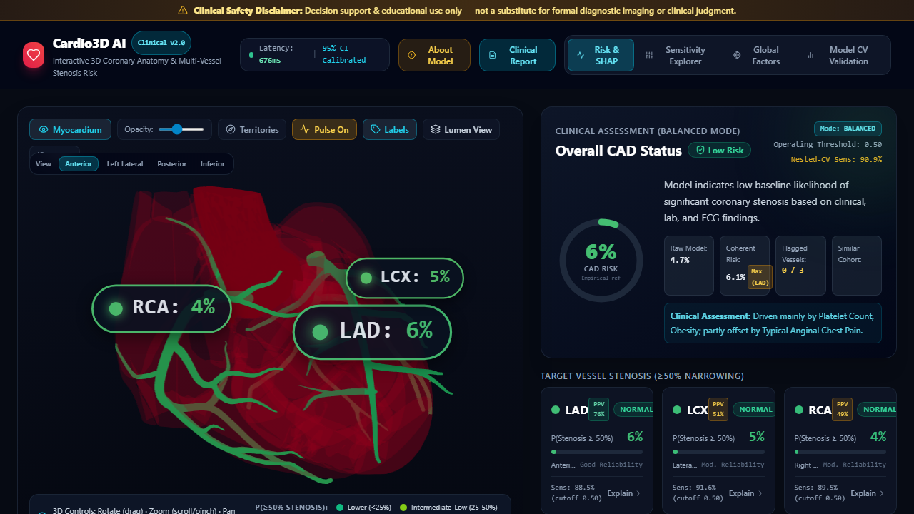
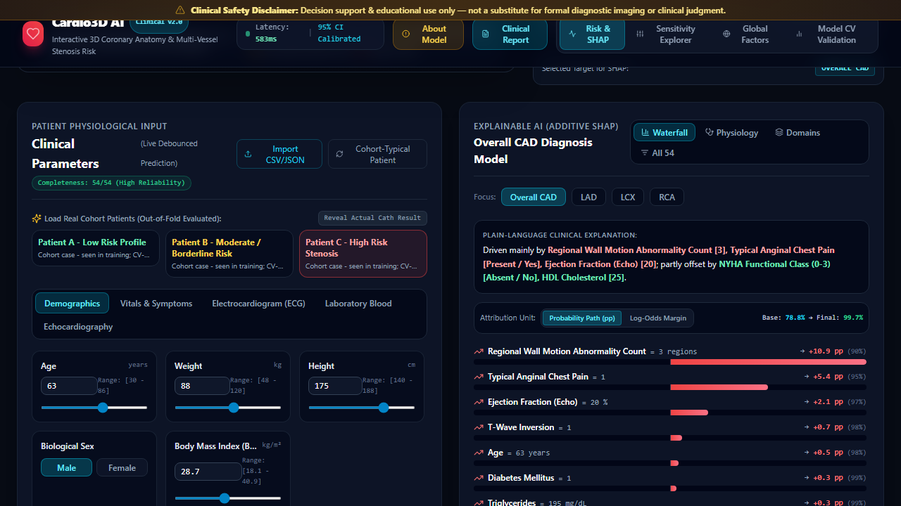
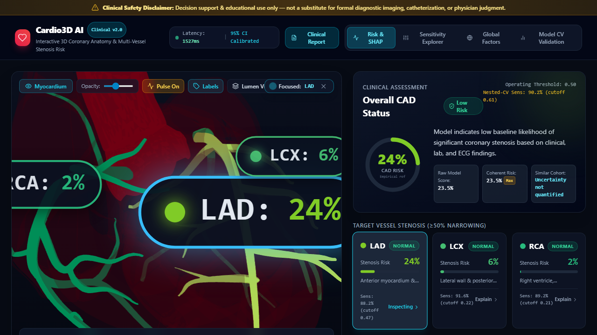

# Cardio3D AI: Cardiovascular Risk & 3D Coronary Stenosis Viewer
[](https://github.com/hackerabi2005/cad/actions/workflows/ci.yml)

**Multimodal AI Hackathon 2026 — Track A (Cardiovascular Risk Visualization & Prediction)**  
*Evaluation Submission Release: [`v1.1.0`](https://github.com/hackerabi2005/cad/releases/tag/v1.1.0)*

> **Clinical Safety Disclaimer**: Decision support / educational purposes only — not a substitute for formal diagnostic imaging.

### 📑 Project Deliverables
- **📄 Official Technical Report**: [`docs/report.pdf`](docs/report.pdf) — Official 5-page PDF technical report (strictly ≤ 6 pages per evaluation rubric; `docs/report.md` serves as supplementary markdown reference).
- **🎥 Video Demonstration**: [Walkthrough recording pending final upload — presentation script verified in docs/VIDEO.md](docs/VIDEO.md) — Video transcript and walkthrough covering patient input workflows, 3D heart interaction, SHAP attribution, what-if sensitivity analysis, and clinical safety.
- **🏛️ Architecture & System Spec**: [`ARCHITECTURE.md`](ARCHITECTURE.md) — Complete end-to-end design, sequence flows, DCA analysis, and extensibility documentation.

> **Judged Submission Note**: The primary judged application is run via Docker Compose (`docker compose up --build`). The experimental Rust/HTMX implementation under `extras/rust-htmx/` and local developer logs (`CLAUDE.md`, `PLAN.md`) are optional development artifacts.

---

## 🌟 Highlights
- **Predictive ML Pipeline**: Multi-task classification predicting overall CAD status ($\text{ROC-AUC} = 0.930$ [$0.898, 0.957$], CV mean $0.932 \pm 0.021$) alongside vessel stenosis for the **LAD** ($\text{AUC} = 0.841$ [$0.794, 0.881$], CV mean $0.840 \pm 0.050$), **LCX** ($\text{AUC} = 0.732$ [$0.676, 0.787$], CV mean $0.724 \pm 0.068$), and **RCA** ($\text{AUC} = 0.744$ [$0.685, 0.798$], CV mean $0.741 \pm 0.056$) with zero target leakage.
- **Decision Curve Analysis (DCA)**: Evaluated across clinical thresholds ($p_t \in [0.05, 0.75]$) on out-of-fold predictions. At screening cutoff $0.400$ (prevalence $\pi = 71.6\%$, sensitivity $95.9\%$, specificity $62.8\%$), delivers a **+8.91 net benefit gain per 100 patients [5.06, 12.43]** over Treat-All for Cath (+12.23 for LAD; +4.13 for LCX; +2.93 for RCA), evaluating apparent single-centre clinical utility.
- **Demographic Fairness Audit**: Evaluated across sex (Male 95.4% sens, 57.8% spec vs Female 96.5% sens, 68.3% spec) and age strata (Age ≤ 65 93.7% sens, 67.1% spec vs Age > 65 100.0% sens, 30.0% spec) with Wilson 95% intervals; strata sum exactly to pooled counts (208 TP / 54 TN); senior specificity reflects small non-CAD sample size (3/10 normal correctly identified) and is explicitly documented as a clinical limitation.
- **Interactive 3D Heart Anatomy**: Real-time WebGL anatomical heart rendered with Three.js & React Three Fiber using BodyParts3D meshes (83,600 triangles total, benchmarking at **median frame time 114.5 ms / ~8.8 FPS, p95 = 131.4 ms** under pure CPU software rendering `--disable-gpu` at 1280×720 on 13th Gen Intel Core i5-13420H, Chromium 148; 60+ FPS on hardware-accelerated GPU; measured in `reports/fps_benchmark.json`).
- **Camera Fly-To, Pulsing & Lumen Schematic**: Dynamic camera fly-to framing on vessel click, real-time emissive pulsating alerts on stenotic vessels, and an interactive 2D transverse lumen cross-section schematic illustrating binary stenosis (normal vs. ≥ 50%).
- **Exact Additive SHAP & Clinical Domains**: Instantaneous feature attribution with mathematical additivity ($\text{error} < 10^{-4}$) aggregated into 5 clinical physiological domains (Demographics & Classical Risk, Vitals & Physical Exam, Laboratory Blood, ECG & Symptoms, Echo & Structure).
- **Model Sensitivity Explorer**: Interactive exploration of live changes in model score ($\Delta P$) when adjusting continuous and binary clinical inputs, with explicit notice that cross-sectional models do not estimate treatment effects.
- **1-Click Clinical Report & Docker Ready**: Printable clinical assessment summary with 3D coronary snapshot, disclaimer watermark, Wilson 95% intervals, and 3-command Docker deployment.

---

## 📸 Workstation Visual Overview


*Figure 1: Cardio3D AI Clinical Workstation with interactive 3D coronary anatomy, live risk gauge, and vessel cards.*


*Figure 2: Multi-vessel stenosis risk mapping with localized color interpolation.*


*Figure 3: Exact additive TreeSHAP attribution waterfall for the Left Anterior Descending artery.*

---


## 🚀 Quickstart

### Option A: Docker (3 Commands)
```bash
git clone https://github.com/hackerabi2005/cad.git
cd cad
docker compose up --build
```
Open **[http://localhost:8000](http://localhost:8000)** in your browser.

### Option B: Local Setup (5 Commands)
```bash
# 1. Install ML & backend dependencies
pip install -r ml/requirements.txt

# 2. Build the web frontend
cd web && npm install && npm run build && cd ..

# 3. Assemble and optimize 3D heart GLB asset
python scripts/prepare_heart_mesh.py

# 4. Train models & generate SHAP artifacts (~2.5-3 min on CPU including nested CV)
python -m ml.train

# 5. Launch the unified application server
python -m uvicorn api.main:app --host 127.0.0.1 --port 8000
```
Open **[http://localhost:8000](http://localhost:8000)** in your browser.

> **Optional Alternative Stack**: An ultra-lightweight Rust (Axum) + HTMX hypermedia implementation is available under [extras/rust-htmx/](extras/rust-htmx/README.md).

---

## 🧪 Verification & Testing

Run the automated test suite verifying leakage prevention, label consistency, API contract, and UI performance:

```bash
# 1. Run all unit tests (label consistency, zero-leakage, API contracts, SHAP consistency)
python -m pytest ml/tests/ api/tests/ -v

# 2. Verify end-to-end browser interactions and 5-second orbit FPS benchmark
python scripts/test_ui_playwright.py

# 3. Compile technical report PDF and verify page count (<= 6 pages)
python scripts/generate_pdf_report.py
```

---

## 📊 Model Evaluation Summary

<!-- METRICS:START -->

### Balanced Operating Threshold (0.50)

| Target | Threshold | ROC-AUC (95% CI) | PR-AUC (95% CI) | Accuracy (95% CI) | Sensitivity (95% CI) | Specificity (95% CI) | F1-Score | Brier |
|---|---|---|---|---|---|---|---|---|
| **Cath** | 0.500 | 0.930 [0.898, 0.957] | 0.972 [0.955, 0.985] | 0.878 [0.838, 0.914] | 0.945 [0.913, 0.972] | 0.709 [0.610, 0.802] | 0.917 [0.888, 0.943] | 0.097 [0.077, 0.118] |
| **LAD** | 0.500 | 0.841 [0.794, 0.881] | 0.880 [0.833, 0.917] | 0.785 [0.739, 0.828] | 0.853 [0.798, 0.903] | 0.691 [0.609, 0.768] | 0.823 [0.780, 0.864] | 0.158 [0.138, 0.181] |
| **LCX** | 0.500 | 0.732 [0.676, 0.787] | 0.591 [0.507, 0.689] | 0.683 [0.630, 0.733] | 0.504 [0.418, 0.595] | 0.799 [0.739, 0.850] | 0.556 [0.470, 0.627] | 0.204 [0.183, 0.224] |
| **RCA** | 0.500 | 0.744 [0.685, 0.798] | 0.621 [0.527, 0.722] | 0.706 [0.657, 0.756] | 0.456 [0.369, 0.546] | 0.857 [0.806, 0.906] | 0.539 [0.455, 0.619] | 0.196 [0.174, 0.216] |

### Sensitivity-First Screening Threshold

| Target | Threshold | ROC-AUC (95% CI) | PR-AUC (95% CI) | Accuracy (95% CI) | Sensitivity (95% CI) | Specificity (95% CI) | F1-Score | Brier |
|---|---|---|---|---|---|---|---|---|
| **Cath** | 0.400 | 0.930 [0.898, 0.957] | 0.972 [0.955, 0.985] | 0.865 [0.825, 0.901] | 0.959 [0.930, 0.982] | 0.628 [0.525, 0.732] | 0.910 [0.881, 0.936] | 0.097 [0.077, 0.118] |
| **LAD** | 0.420 | 0.841 [0.794, 0.881] | 0.880 [0.833, 0.917] | 0.776 [0.729, 0.822] | 0.904 [0.859, 0.943] | 0.595 [0.511, 0.680] | 0.825 [0.783, 0.864] | 0.158 [0.138, 0.181] |
| **LCX** | 0.248 | 0.732 [0.676, 0.787] | 0.591 [0.507, 0.689] | 0.624 [0.571, 0.677] | 0.908 [0.853, 0.957] | 0.440 [0.368, 0.514] | 0.654 [0.593, 0.710] | 0.204 [0.183, 0.224] |
| **RCA** | 0.232 | 0.744 [0.685, 0.798] | 0.621 [0.527, 0.722] | 0.607 [0.551, 0.660] | 0.903 [0.846, 0.952] | 0.429 [0.358, 0.500] | 0.634 [0.567, 0.693] | 0.196 [0.174, 0.216] |

*Clinical Disjunctive Coherence Rule (Overall CAD flagged if $P(\text{CAD}) \ge 0.400$ OR any vessel flagged): Sensitivity rises to **96.3% (209/217)** [95% CI 93.1–98.2%] with specificity **57.0% (49/86)** [95% CI 46.5–67.4%], ensuring zero missed multi-vessel stenoses in clinical triage.*

<!-- METRICS:END -->

*Note: Evaluated across Repeated Stratified 5-Fold Cross-Validation with 3 Repeats (15 total folds). 95% confidence intervals derived from 2,000 stratified bootstrap resamples on pooled out-of-fold predictions.*

> **Clinical Operating Tradeoff**: When tuned for $\ge 90\%$ screening sensitivity, honest nested cross-validation estimates (pooled across all 15 outer test folds) are: **Cath**: $90.2\%$ sensitivity / $80.6\%$ specificity; **LAD**: $88.1\%$ sensitivity ($88.2\% \pm 7.2\%$ fold mean) / $62.2\%$ specificity; **LCX**: $91.6\%$ sensitivity / $35.1\%$ specificity; and **RCA**: $89.2\%$ sensitivity / $38.6\%$ specificity (with full-cohort apparent OOF specificity of $37.0\%$ and $39.2\%$; see [reports/threshold_nested.md](reports/threshold_nested.md)). This tradeoff is clinically intentional: in cardiovascular screening-style workflows, missing significant coronary stenosis (false negative) carries far greater risk than scheduling confirmatory non-invasive imaging (false positive). LCX labels exhibit lower precision under high-sensitivity tuning, reflecting moderate discrimination ($\text{AUC} \approx 0.735$) and low-confidence single-vessel boundaries.

---

## 🫀 3D Anatomical Heart Model

- **Source**: BodyParts3D (Database Center for Life Science, Japan).
- **Extracted Nodes**:
  - `LAD`: Trunk of anterior interventricular branch + diagonal & septal branches (13,574 triangles).
  - `LCX`: Trunk of circumflex branch + posterior ventricular branches (19,160 triangles).
  - `RCA`: Trunk of right coronary artery + marginal, conus, AV nodal branches (13,764 triangles).
  - `Aorta`: Ascending aorta and bulb (6,572 triangles).
  - `Heart_Muscle`: Decimated myocardium shell (30,530 triangles).
- **Total Asset Size**: 1.67 MB GLB, 83,600 triangles (budget $\le 100,000$).
- **Software Rendering Benchmark**: **median frame time 114.5 ms (~8.8 FPS continuous orbit, p95 = 131.4 ms)** under pure CPU software rendering (`--disable-gpu` at 1280×720 on 13th Gen Intel Core i5-13420H, Chromium 148; measured in [reports/fps_benchmark.json](reports/fps_benchmark.json)). Renders at 60+ FPS on a hardware-accelerated GPU.

---

## 🧩 Architectural Extensibility

Cardio3D AI provides a declarative, configuration-driven architecture where models, UI, and 3D representations adapt dynamically:
- **`ml/targets.json` & `web/src/targets.json`**: Central target registry mapping diagnostic targets to models, meshes, cutoffs, and AHA 17-segment perfusion zones.
- **`ml/schema.json`**: Feature registry specifying encoding, units, physiological bounds, and clinical domains.
- **`web/src/vessels.json`**: Declarative mapping of anatomical mesh nodes, territories, 3D badge coordinates, and cutoff-anchored color ramps.

### 🛠️ How to Add a Feature, Model, or Vessel in 3 Steps

1. **Add Feature / Biomarker**: Append the feature definition to `ml/schema.json` with its `domain` (`"demographics"`, `"symptoms_exam"`, `"ecg"`, `"labs"`, or `"echo"`), `encoding`, physiological bounds (`phys_min`, `phys_max`), and cohort median. The patient input form and input completeness gates adapt automatically.
2. **Add / Reconfigure Target or Vessel**: Add the target entry to `ml/targets.json` with its corresponding model pipeline, mesh node in `heart.glb`, operating cutoffs, and perfusion territory. The 3D viewer, vessel cards, SHAP inspector, and metrics tabs loop over this registry.
3. **Retrain & Rebuild**: Run `python -m ml.train` to fit pipelines and compute out-of-fold metrics, then run `npm run build` in `web/`. The multi-vessel 3D visualizer, SHAP explainers, and metrics dashboard immediately reflect the new configuration.

---

## 📜 Provenance & Licenses
- **Model Provenance**: Shipped artifacts trained locally on Windows 11 (Python 3.14.5, seed 42) and verified on Python 3.12 (Linux/WSL2).
- **Software Code**: MIT License (see [LICENSE](LICENSE)).
- **Clinical Dataset**: Alizadehsani et al. (2017), Shaheed Rajaei Cardiovascular, Medical and Research Center in Tehran (UCI Machine Learning Repository, CC BY 4.0, DOI: 10.17632/bgf5czvpg2.1).
- **3D Anatomical Heart Model**: BodyParts3D © Database Center for Life Science, Japan (CC BY-SA 2.1 Japan). The derived model file `heart.glb` is released and distributed under the identical CC BY-SA 2.1 Japan license. See [THIRD_PARTY_NOTICES.md](THIRD_PARTY_NOTICES.md).
